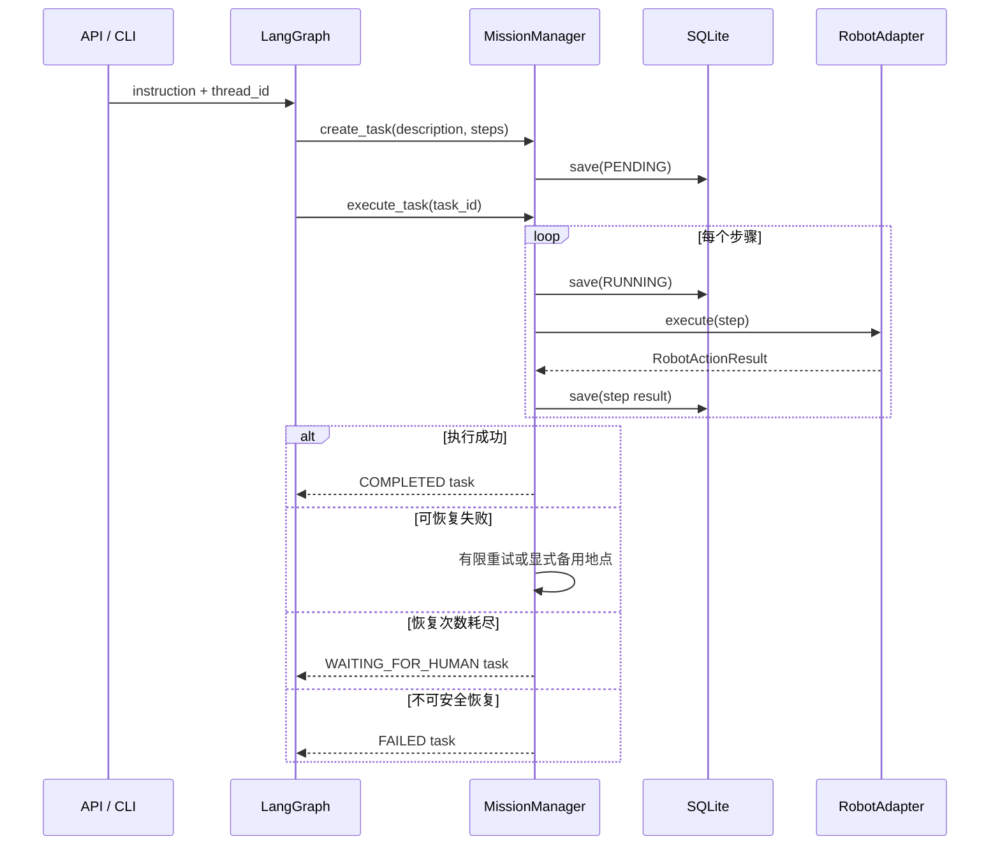

# 当前系统架构

当前实现保持任务执行核心与 ROS2 解耦：

```mermaid
flowchart LR
    Client[CLI / FastAPI Client] --> API[FastAPI Runtime]
    API --> Agent[LangGraph Agent]
    Agent --> Planner[Rule / OpenAI Planner]
    Planner --> Plan[Pydantic TaskPlan]
    Plan --> Registry[ToolRegistry + LocationCatalog]
    Registry --> MM[MissionManager]
    Agent --> Checkpoints[(SQLite checkpoints.db)]
    MM --> Recovery[RecoveryPolicy]
    MM --> Models[Pydantic models]
    MM --> Repo[SQLiteTaskRepository]
    Repo --> Events[(task_events)]
    MM --> Port[RobotAdapter interface]
    Port --> Fake[FakeRobotAdapter]
    Port --> ROS[ROS2RobotAdapter]
    ROS --> Nav2[NavigateToPose Action]
    ROS --> Odom[/odom]
    MM --> Router[CapabilityRouterAdapter]
    Router --> Camera[ROS2CameraSource + cv_bridge]
    Router --> Detector[Ultralytics YOLO Detector]
    Camera --> Image[/camera/image_raw]
    Detector --> Decision[objects_detected / clear]
    Eval[Phase 7 EvaluationRunner] --> Agent
    Eval --> MM
    Eval --> Fake
    Eval --> Reports[(JSONL + JSON + Markdown)]
```

Agent 图只允许 `plan → validate → create_task → execute`。`create_task` 会先把任务 ID
和 thread 关联写入任务库与 checkpoint，再允许机器人执行。任何规划错误、未知地点、未注册工具或
未实现能力都会路由到失败终态，不进入 MissionManager。

Phase 5 激活了 `capture_image` 和 `detect_objects`。`CapabilityRouterAdapter` 根据 action
把导航/状态动作交给机器人 adapter，把拍照/检测动作交给 `PerceptionAdapter`。检测完成后
LangGraph 读取结构化 `target_presence`，进入 `objects_detected` 或 `clear` 分支。

`MissionManager` 只依赖 `RobotAdapter` 接口，不知道动作来自模拟器还是 ROS2。
Phase 2 通过新增 `ROS2RobotAdapter` 完成接入，没有修改任务执行规则。

任务和步骤的状态变化统一经过 `mission/fsm.py` 校验。任务管理器同一时间只允许一个任务使用机器人，避免两个任务同时发送互相冲突的动作。Phase 4 的
`RecoveryPolicy` 只输出确定性的 `retry`、`use_fallback`、`request_human` 或 `fail`，
并同时受单步骤和整单失败上限约束。

FastAPI lifespan 独占异步 SQLite checkpointer 的连接生命周期。任务实体/事件位于
`tasks.db`，LangGraph thread 状态位于 `checkpoints.db`，两者用任务 `context.agent_thread_id`
关联。进程重启若发现 `RUNNING` 任务，会把运行步骤恢复为 `PENDING`、任务隔离为
`WAITING_FOR_HUMAN`，并同步 checkpoint；不会自动重发上一条机器人动作。

当前执行序列：



暂停和取消采用协作式控制：控制请求先通知当前 `RobotAdapter` 取消动作，执行循环确认动作结束后再写入 `PAUSED` 或 `CANCELLED`。暂停时被中断的步骤恢复为 `PENDING`，恢复任务后重新执行；因此未来每个机器人技能都必须明确是否可安全重试。

单步执行由 `asyncio.wait_for` 限时。超时等瞬态错误最多执行配置数量的尝试；恢复预算
耗尽后进入 `WAITING_FOR_HUMAN`，不会无限重试。非法参数和未知错误不会自动重试。

地点目录可为一个目标声明单一备用点。目前 `laboratory_door` 的备用点是
`corridor_observation`。该映射由配置文件确定，LLM 不能在失败后临时生成坐标。

安全边界：任务层只能提交预定义动作及结构化参数。Fake adapter 不产生物理动作；
ROS2 adapter 会校验参数和地图边界，并支持超时和取消。LLM 不会直接发布 `cmd_vel`。

Phase 7 的 `EvaluationRunner` 不改变生产执行链。它通过现有公共接口注入确定性的成功、
障碍、导航失败、工具失败、感知失败、进程中断和人工暂停，并从真实 Task/TaskStep 快照
计算指标。原始记录与汇总报告分离，防止只保留百分比而无法追溯单次执行。

