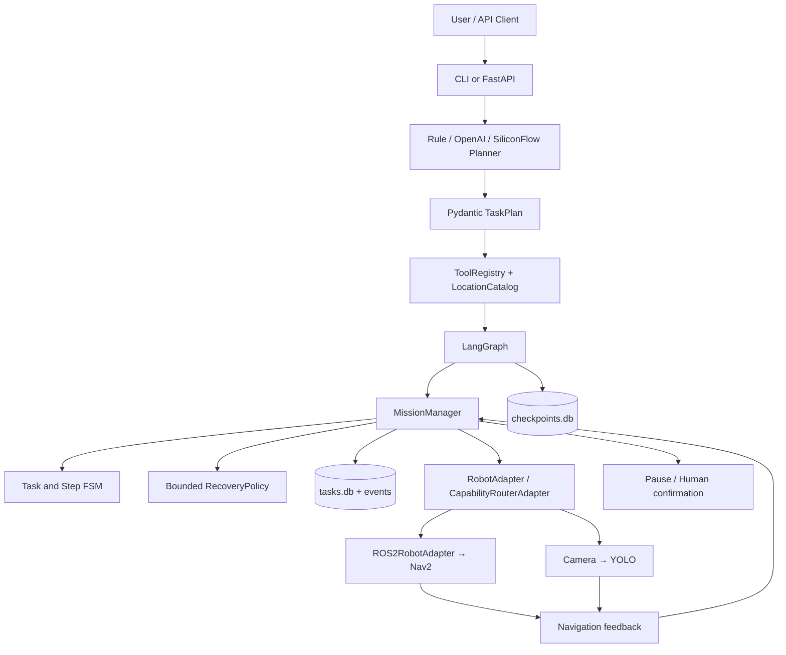
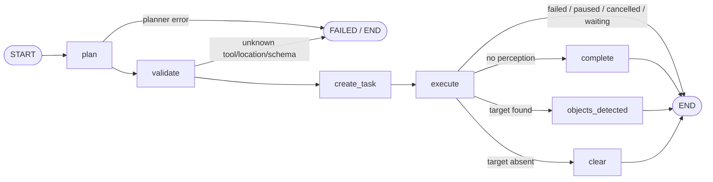
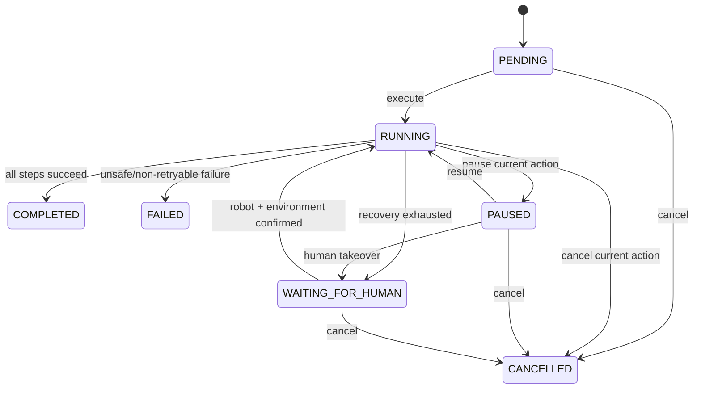
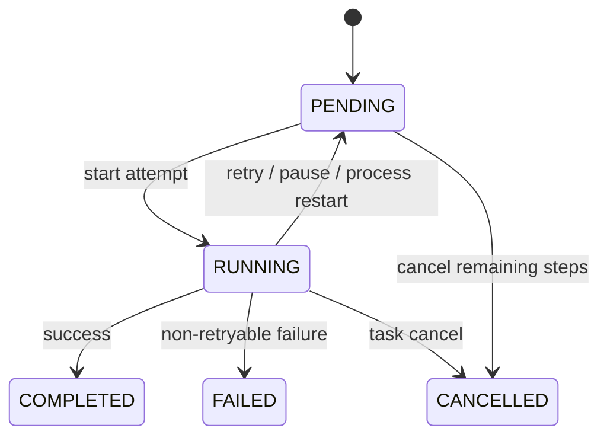
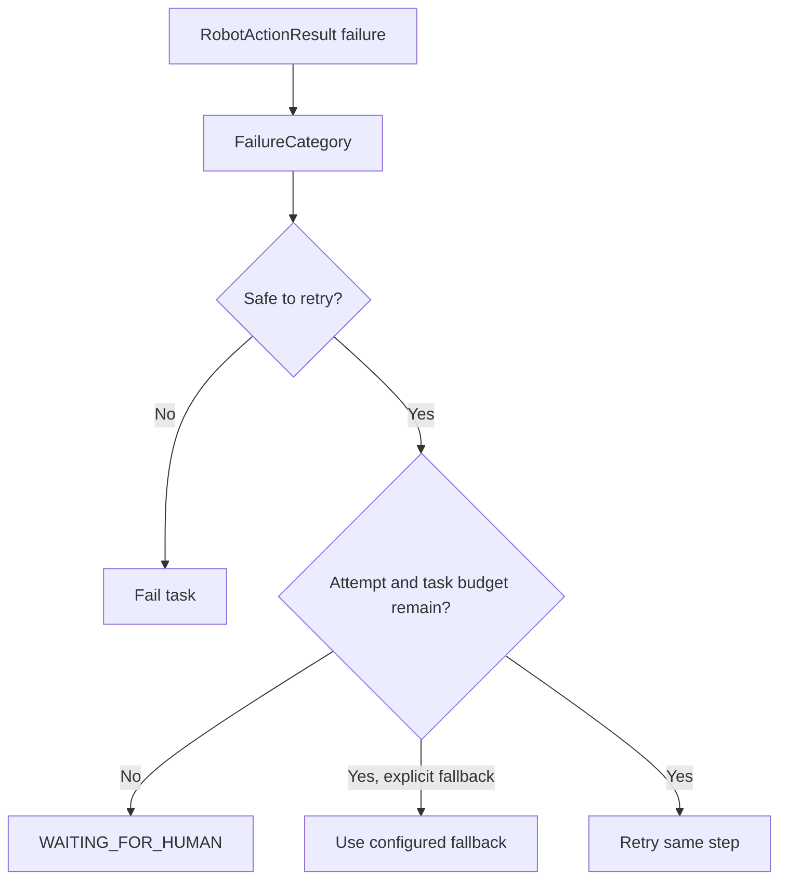
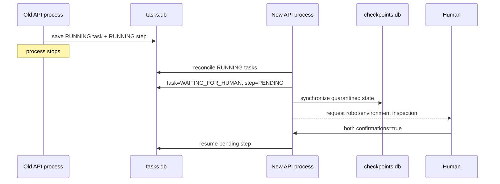

# 系统图、Agent 工作流与 FSM

## 1. 分层系统架构

## 2. Agent 工作流

`create_task` 在机器人动作前写入任务 ID 和 `agent_thread_id`，确保中断后能关联任务数据库与
checkpoint。LLM 输出必须先通过 Pydantic、地点目录和 Tool Registry，不能直接调用底盘。

## 3. Task FSM

## 4. Step FSM 与恢复

## 5. 重启恢复时序

